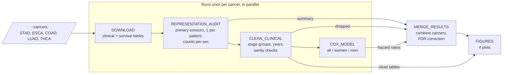

# Sex differences in cancer survival: a reproducible Nextflow pipeline

## Contents
1. [Background](#background)
2. [Pipeline overview](#pipeline-overview)
3. [Design rationale](#design-rationale)
4. [Dependencies](#dependencies)
5. [Installation and usage](#installation-and-usage)
6. [Expected outputs](#expected-outputs)
7. [Directory structure](#directory-structure)
8. [Citations](#citations)

## Background

Women have historically been underrepresented in parts of biomedical research. Statistical and artificial intelligence models learn from data: if a group is a minority, there is less to learn from. This matters especially for survival models, among the most widely used models in cancer research, because they compare groups at the moments when deaths occur. When deaths are sparse, estimates can be unstable and confidence intervals wide, even when the model runs successfully.

How much we can learn about each group therefore depends both on who is in the dataset and on how many deaths are observed during follow-up.

This pipeline asks three questions across five cancer cohorts from The Cancer Genome Atlas (TCGA):

1. **Who is represented?**
   Among eligible patients with a survival record, what share is recorded as female or male? How often are key clinical fields missing in each group?
2. **Is recorded sex associated with overall survival?**
   Within each cancer, a pooled Cox model estimates the association after adjusting for age and stage.
3. **How much evidence supports estimates within each sex?**
   The pipeline counts observed deaths in each group and flags female-only and male-only models with few events.

The workflow applies the same eligibility rules and audit to every cancer, so representation and the association between sex and survival can be compared across cancer types. These counts describe representation within TCGA; judging underrepresentation relative to who develops each cancer would require a population benchmark.


## Pipeline overview



| Stage | Process | What it does | Main output |
|---|---|---|---|
| **Data acquisition** | `DOWNLOAD` | Fetches clinical and survival tables from the UCSC Xena GDC hub, records md5 checksums, makes raw files read-only | `data/raw/` |
| **Preprocessing** | `REPRESENTATION_AUDIT` | Keeps primary tumours only and one sample per patient to eliminate overrepresentation, counts patients, deaths and missing data per sex | `results/audit/` |
| | `CLEAN_CLINICAL` | Groups AJCC stages into I–IV, converts survival to years, drops unusable patients, runs sanity checks | `data/processed/`, `results/clean/` |
| **Analysis** | `COX_MODEL` | Fits three Cox models: all patients (sex + age + stage), women only and men only (age + stage) | `results/cox/` |
| **Reporting** | `MERGE_RESULTS` | Combines all cancer types and corrects p-values for multiple testing (Benjamini–Hochberg FDR) | `results/summary/` |
| | `FIGURES` | Draws four desired summary figures | `results/figures/` |

The first four steps run **independently for each cancer**, in parallel. `MERGE_RESULTS` waits for all cancers before combining them.

## Design rationale

**Data:**
Public, clinical data from The Cancer Genome Atlas (TCGA), downloaded automatically from the UCSC Xena GDC hub.  TCGA is a used open cancer dataset that records sex, age, stage and survival in the same format for every cohort.
 
| File | Source URL | Used for |
|---|---|---|
| `TCGA-<CODE>.clinical.tsv.gz` | `https://gdc.xenahubs.net/download/TCGA-<CODE>.clinical.tsv.gz` | sex, age, AJCC pathologic stage, sample type |
| `TCGA-<CODE>.survival.tsv.gz` | `https://gdc.xenahubs.net/download/TCGA-<CODE>.survival.tsv.gz` | overall survival time (days) and vital status |
 
Cohorts: STAD (stomach), ESCA (oesophagus), COAD (colon), LUAD (lung adenocarcinoma), THCA (thyroid). 

**Why these five cancers?** These five cancers are chosen to represent different representation distributions after calculating sex representation for each cancer.

| Cancer | Code | Role |
|---|---|---|
| Stomach adenocarcinoma | STAD | Women are a minority (35%) |
| Oesophageal carcinoma | ESCA | Extreme gap: women are 15% of patients |
| Colon adenocarcinoma | COAD | Close to balanced |
| Lung adenocarcinoma | LUAD | Balanced; the largest number of deaths |
| Thyroid carcinoma | THCA | The reverse: men are the minority (27%) |


**Why a Cox proportional-hazards model.** It is the standard model for time-to-event data. 
    All patients model: estimation of the effect of sex after adjusting for age and stage.
    The women-only and men-only models: show how precisely each sex can be modelled on its own.

**Why flag models with fewer than 40 deaths.** A common rule of thumb for Cox regression is about 10 events per estimated term (Peduzzi et al., 1995). The sex-specific models estimate four terms (age + three stage terms), giving 4 × 10 = 40 deaths. 

The same rule is applied to the pooled sex comparison: sex is one term, so it is flagged if either sex contributes fewer than 10 deaths, because a comparison is only as reliable as its smaller group. The 40-death threshold can be changed with `--min_events`.

## Dependencies

**Core (installed by the user)**

| Tool | Version | Purpose |
|---|---|---|
| [Nextflow](https://www.nextflow.io) | 24.10.0 | Workflow manager |
| [Docker Desktop](https://www.docker.com/products/docker-desktop/) | any recent | Runs the pipeline's container |
| [Conda](https://docs.conda.io/en/latest/miniconda.html) (Miniconda) | any recent | Used only to install Nextflow |

**Pipeline**

Image: [`caglayaniris/sex-survival:0.1.0`](https://hub.docker.com/r/caglayaniris/sex-survival) 
- (linux/amd64, linux/arm64), built using `envs/Dockerfile` and `envs/analysis.yml`.
- Docker image size: 2.53 GB.
- Analysis runtime: approximately 10 seconds with previously downloaded data.

| Package | Version | Used for |
|---|---|---|
| Python | 3.11 | All analysis scripts |
| pandas | 2.2.3 | Reading, filtering and merging tables |
| numpy | 1.26.4 | Numerical operations |
| lifelines | 0.29.0 | Cox models and Kaplan–Meier curves |
| statsmodels | 0.14.4 | FDR correction |
| matplotlib | 3.9.2 | Figures |
| curl | — | Downloading data |
| procps-ng | — | Lets Nextflow monitor tasks |


## Installation and usage

### 1. Install conda and Docker if needed
- Install [Miniconda](https://docs.conda.io/en/latest/miniconda.html) and check with `conda --version`.
- Install [Docker Desktop](https://www.docker.com/products/docker-desktop/), **open it** so it is running, and check with `docker --version`.
### 2. Install Nextflow (once)
```bash
conda create -n nextflow -c conda-forge -c bioconda nextflow=24.10.0
conda activate nextflow
nextflow -version
```
### 3. Get the pipeline
```bash
git clone https://github.com/iriscaglayan/sex_survival_analysis.git
cd sex_survival_analysis
```
### 4. Quick test (2 cancers)
```bash
nextflow run main.nf -profile test
```
Test results are written to `results_test/`.

### 5. Full run (5 cancers)
```bash
nextflow run main.nf
```
Results are written to `results/`. On the first run, Nextflow downloads the Docker image from Docker Hub automatically; no `docker build` is needed.

## Expected outputs

Running the full pipeline should match with the files in `expected_outputs/` **exactly** because the analysis contains no randomness.


| Folder | Contents |
|---|---|
| `results/audit/` | Per cancer: filtered patient table, counts per sex, small bar chart |
| `results/clean/` | Per cancer: model-ready table and a report of dropped patients per sex |
| `results/cox/` | Per cancer: hazard ratios with 95% CI for all three models |
| `results/summary/` | `sex_effect.csv` (headline table, one row per cancer, with FDR q-values), plus combined audit, dropped and Cox tables |
| `results/figures/` | Four figures: [Representation](expected_outputs/figures/fig1_representation.png), [Sex effect](expected_outputs/figures/fig2_sex_effect.png), [Precision gap](expected_outputs/figures/fig3_precision_gap.png), [Survival curves](expected_outputs/figures/fig4_km_by_sex.png) |
| `results/pipeline_info/` | Timeline of the run (shows cancers running in parallel) |
| `data/processed/` | Cleaned table per cancer |

To verify reproducibility, you can compare produced figures or run:
```
    diff -r expected_outputs/summary results/summary
```
## Directory structure

```
.
├── main.nf                 # workflow: connects the six processes
├── nextflow.config         # parameters, container, resources, profiles
├── conf/
│   └── test.config         # test profile: STAD + THCA only
├── modules/                
│   ├── download.nf
│   ├── audit.nf
│   ├── clean.nf
│   ├── cox.nf
│   ├── merge.nf
│   └── figures.nf
├── bin/                    # Python scripts run by the processes
│   ├── representation_audit.py
│   ├── clean_clinical.py
│   ├── cox_model.py
│   ├── merge_results.py
│   └── make_figures.py
├── envs/
│   ├── Dockerfile          # recipe for the container image
│   └── analysis.yml        # packages installed in the image
├── expected_outputs/       # results to compare against (figures, tables, data checksums)
└── README.md

Created when the pipeline runs, not provided on GitHub:
├── data/raw/               # downloaded TCGA tables (read-only)
├── data/processed/         # cleaned tables
├── results/                # all outputs
└── work/                   # Nextflow's working folders
```

## Citations

- **TCGA**: Weinstein JN *et al.* (2013). The Cancer Genome Atlas Pan-Cancer analysis project. *Nature Genetics* 45:1113–1120.
- **GDC**: Grossman RL *et al.* (2016). Toward a shared vision for cancer genomic data. *New England Journal of Medicine* 375:1109–1112.
- **UCSC Xena**: Goldman MJ *et al.* (2020). Visualizing and interpreting cancer genomics data via the Xena platform. *Nature Biotechnology* 38:675–678.
- **Nextflow**: Di Tommaso P *et al.* (2017). Nextflow enables reproducible computational workflows. *Nature Biotechnology* 35:316–319.
- **lifelines**: Davidson-Pilon C (2019). lifelines: survival analysis in Python. *Journal of Open Source Software* 4(40):1317.
- **Events per variable**: Peduzzi P *et al.* (1995). Importance of events per independent variable in proportional hazards regression analysis II. *Journal of Clinical Epidemiology* 48:1503–1510.
- **FDR**: Benjamini Y, Hochberg Y (1995). Controlling the false discovery rate. *Journal of the Royal Statistical Society B* 57:289–300.
Claude was used to solve the erros in code and refine the English rules and structure of README file.
